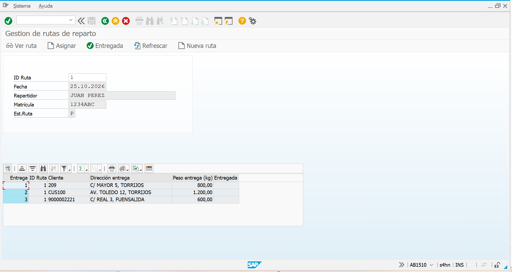
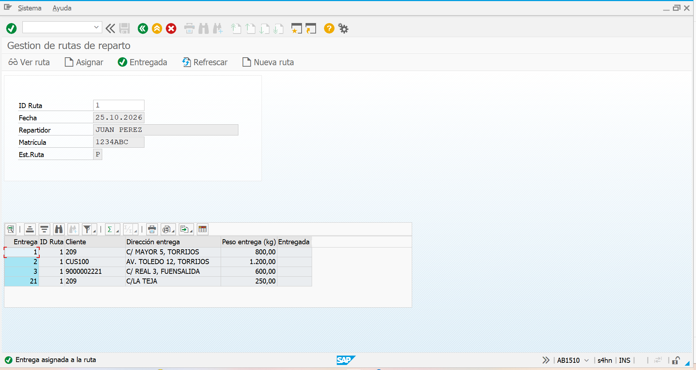
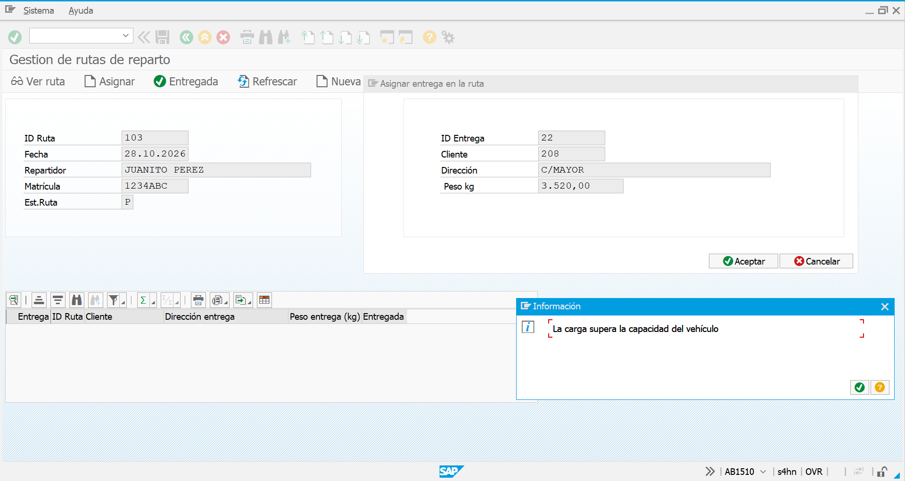
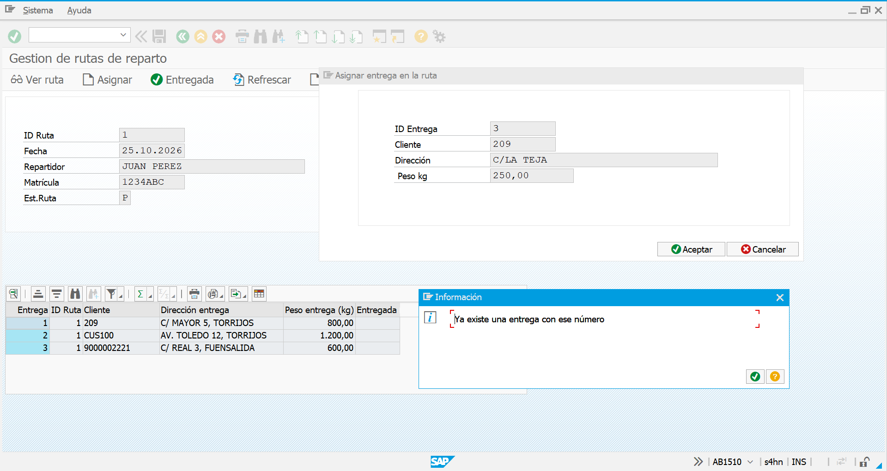
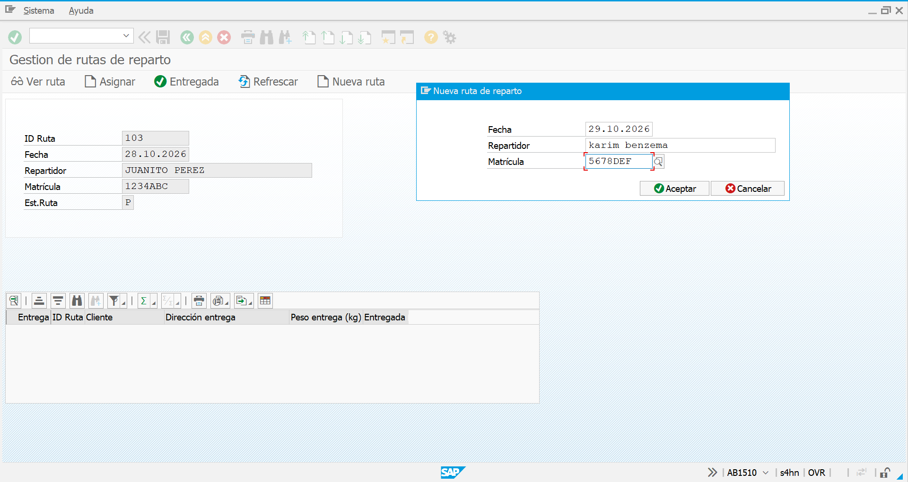
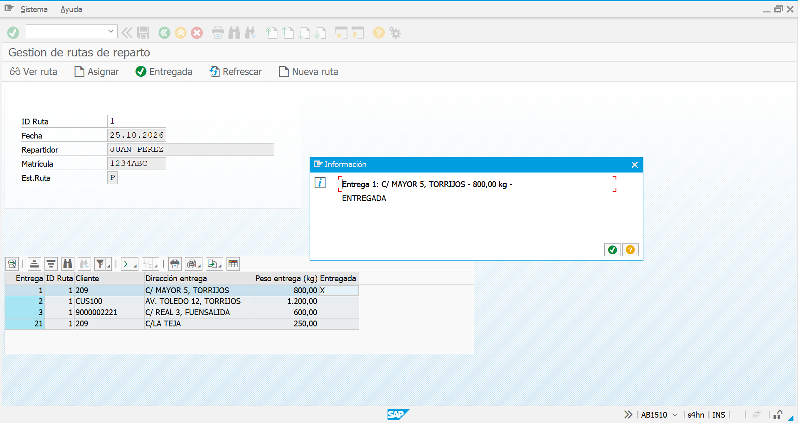
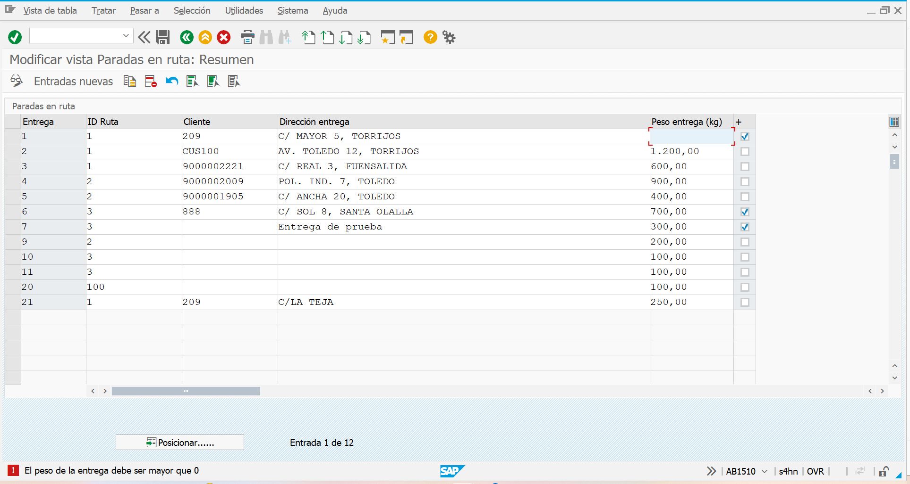
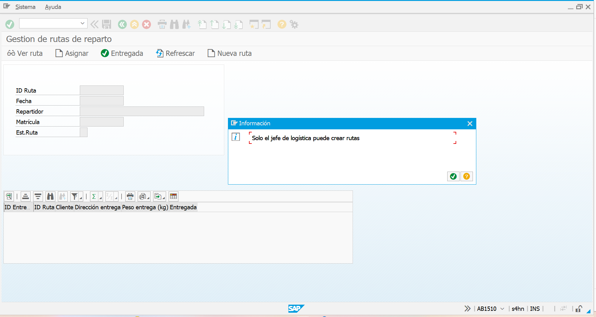
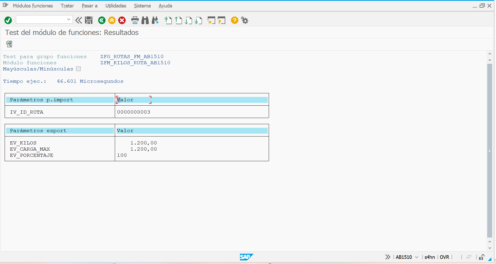
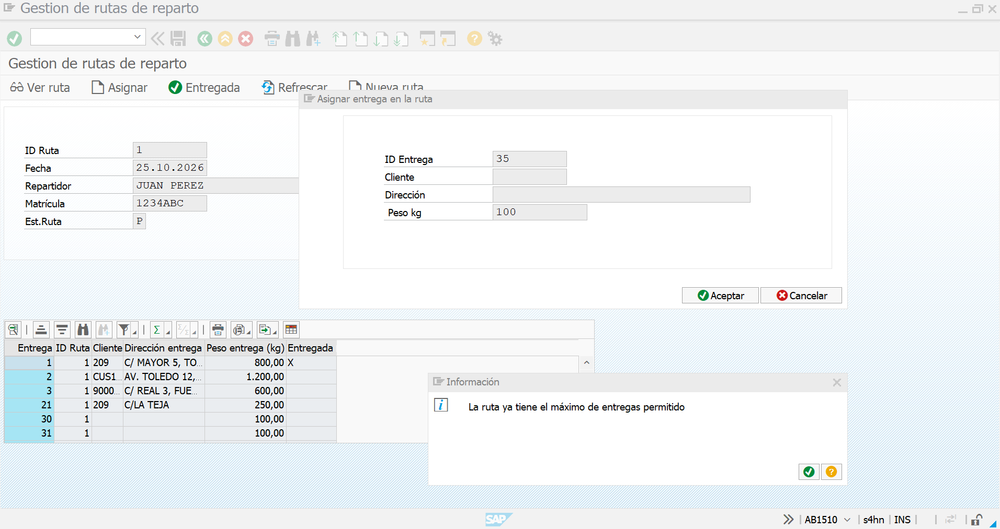

# Gestión de rutas de reparto · SAP ABAP

Aplicación SAP para planificar las rutas de reparto de una empresa de distribución: qué camión sale cada día, qué entregas lleva y si caben en él. Controla la carga máxima del vehículo, valida los datos tanto desde el programa como desde la SM30, y restringe la creación de rutas al jefe de logística.

Proyecto de práctica del programa **SAP Full Stack** (Cloud Formación TIC), inspirado en mi trabajo diario en logística y reparto.



## Qué hace

- **Ver una ruta**: cabecera (fecha, repartidor, camión, estado) y sus entregas en un ALV.
- **Asignar entregas** a la ruta, comprobando que el camión no supere su carga máxima.
- **Marcar entregas** como entregadas.
- **Crear rutas nuevas** con numeración automática (rango numérico SNRO), solo para el jefe de logística.
- **Doble clic** en una entrega para ver su detalle.
- **Módulo de funciones** que devuelve los kilos y el % de ocupación de una ruta, para usarlo desde otros programas.
- **Punto de ampliación propio (BAdI)** para que cada empresa añada sus propias reglas de validación sin modificar la clase principal.

## Técnicas utilizadas

| Área | Qué se ha usado |
|---|---|
| Diccionario (SE11) | Dominios con valores fijos, elementos de datos, 3 tablas transparentes, claves externas 1:CN, tipo tabla |
| ABAP OO (SE24) | Clase `ZCL_RUTAS_AB1510` con métodos de instancia y estático, atributos privados (encapsulamiento) |
| Excepciones | Clase de excepción propia `ZCX_RUTAS_AB1510` con 7 textos, `RAISE EXCEPTION` / `TRY…CATCH` |
| Dynpros | Pantalla principal 9000 + 3 ventanas modales (9001, 9002, 9003), status GUI, `AT EXIT-COMMAND` |
| ALV OO | `CL_SALV_TABLE` en Custom Control, `set_all`, columnas optimizadas, evento `DOUBLE_CLICK` con clase local |
| Validaciones | En la clase (programa) **y** en los eventos del generador de actualización (SM30), para que no entren datos erróneos por ninguna vía |
| Autorizaciones | `AUTHORITY-CHECK` sobre `S_TCODE`, probado simulando un usuario sin permiso en el debugger |
| Numeración | Rango numérico SNRO + `NUMBER_GET_NEXT` |
| Módulo de funciones | `ZFM_KILOS_RUTA_AB1510` que reutiliza la clase y transforma la excepción en clásica |
| Transacciones (SE93) | `ZRUTAS_AB1510` y `ZRUTAS_JEFE_AB1510` |
| Ampliaciones (SE18 / SE19) | BAdI propia `ZBADI_VALIDAR_ENTREGA_AB1510` en el punto de ampliación `ZES_RUTAS_AB1510`, llamada con `GET BADI` / `CALL BADI` e implementada en una clase aparte |

## Modelo de datos

```
ZVEHICULO_AB1510  ──1:CN──>  ZRUTA_AB1510  ──1:CN──>  ZENTREGA_AB1510
   (camión)                   (ruta del día)            (entregas)
```

Detalle de tablas, dominios y claves externas en [diccionario/tablas.md](diccionario/tablas.md).

## Reglas de negocio

| Regla | Dónde se controla |
|---|---|
| Los kilos de la ruta no pueden superar la carga máxima del camión | `ASIGNAR_ENTREGA` |
| El peso de una entrega debe ser mayor que 0 | `ASIGNAR_ENTREGA` + evento 01 SM30 |
| Una ruta nueva no puede tener fecha anterior a hoy | `CREAR_RUTA` + evento 01 SM30 |
| No se puede reutilizar el número de una entrega existente | `ASIGNAR_ENTREGA` |
| Solo se marcan entregas de la propia ruta | `MARCAR_ENTREGADA` |
| La ruta debe llevar un camión existente | Clave externa |
| Solo el jefe de logística crea rutas | `AUTHORITY-CHECK` |
| Máximo 5 entregas por ruta (regla de ejemplo, activable y desactivable) | Implementación de la BAdI `ZCL_IMP_MAX_ENTREGAS_AB1510` |

## Capturas

| | |
|---|---|
| Asignar entrega  | Control de sobrecarga  |
| Entrega repetida  | Nueva ruta  |
| Detalle con doble clic  | Validación en la SM30  |
| Sin autorización  | Módulo de funciones  |
| Regla añadida con BAdI  | |

## Estructura del repositorio

```
src/
├── programa/    ZRUTAS_AB1510 y sus includes (TOP, CLS, PBO, PAI)
├── clase/       ZCL_RUTAS_AB1510, ZCX_RUTAS_AB1510, interfaz e implementación de la BAdI
├── funciones/   ZFM_KILOS_RUTA_AB1510
├── sm30/        Validaciones de los eventos de la SM30
└── test/        Programa de prueba de la clase
diccionario/     Tablas, dominios y claves externas
capturas/        Pantallas de la aplicación
```

## Autor

**Álvaro Salvador Zamora** · [GitHub](https://github.com/alvaroszdev)

Otro proyecto: [Gestión de pedidos de ventas](https://github.com/alvaroszdev/sap-abap-gestion-pedidos)
